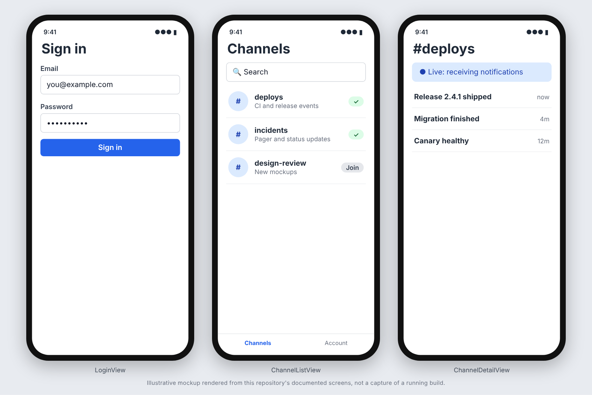

# notifyhub-ios

Native Swift/SwiftUI companion app to
[notifyhub](https://github.com/arb-rajab/notifyhub) — demonstrating real
APNs push notifications end-to-end against notifyhub's GraphQL API and
`notificationReceived` GraphQL subscription.

## Screenshots



_These images are illustrative mockups rendered from this repository's documented screens and API shapes, not captures of a running build. Regenerate or replace them with real captures once the app is running._

## What's here

- Auth against notifyhub's JWT, Keychain-backed.
- Channel browse/search/create/subscribe.
- Notification list per channel, with live updates over notifyhub's
  GraphQL subscription while a channel is open.
- APNs device-token registration/rotation/revocation, wired to
  notifyhub's `registerDeviceToken`/`rotateDeviceToken`/
  `revokeDeviceToken` mutations.
- Push handling and deep-linking in all three app states (foreground,
  background, killed).

See [`docs/project-memory/`](./docs/project-memory/01-brief.md) for the
full brief, architecture, security posture, testing coverage, and ADRs.

## Building

This project uses [XcodeGen](https://github.com/yonaskolb/XcodeGen) -
`NotifyHubIOS.xcodeproj` is generated from `project.yml`, not committed.

```bash
brew install xcodegen
xcodegen generate
open NotifyHubIOS.xcodeproj
```

See [`docs/project-memory/06-ops.md`](./docs/project-memory/06-ops.md)
for command-line build/test invocations and CI details.

## A permanent limitation, not a bug

Real APNs delivery to a physical device can't be verified in CI or any
automated session - it requires a real Apple Developer account, a real
device, and notifyhub's own live credentials, which are never present
in either repo or their CI by design. See
[`docs/project-memory/08-risk.md`](./docs/project-memory/08-risk.md).

## License

MIT - see [LICENSE](./LICENSE).
